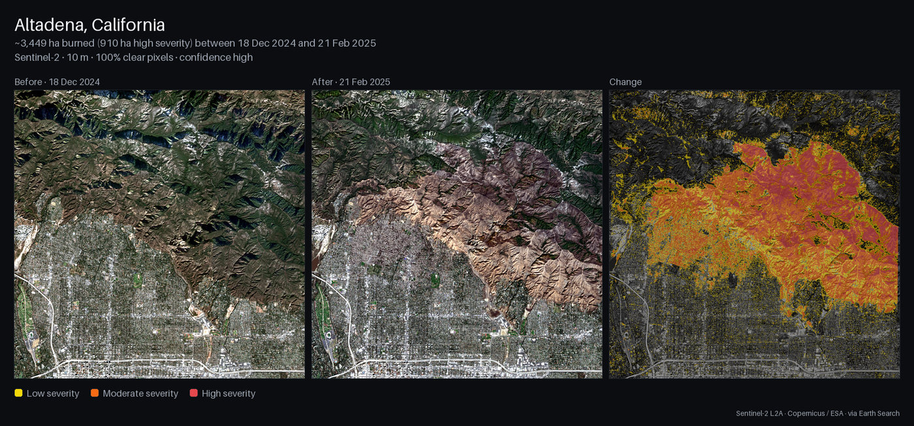
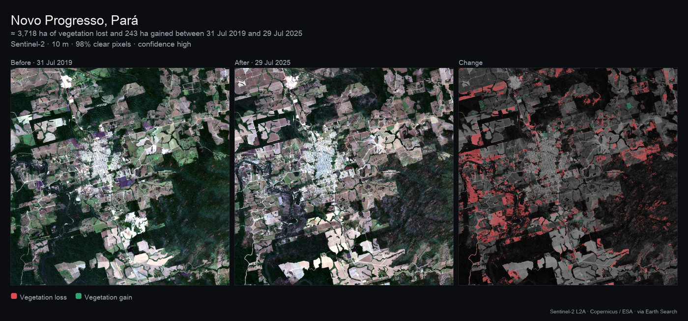
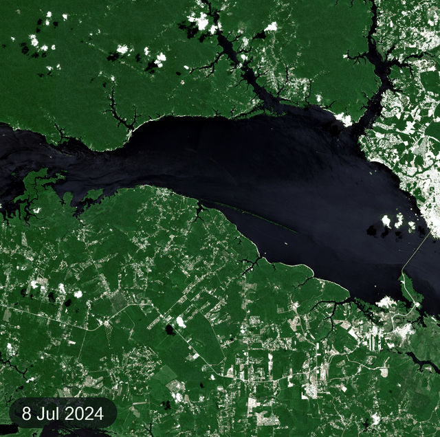
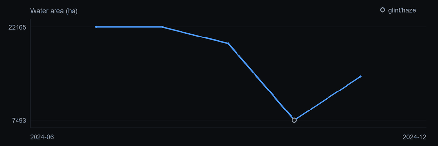

# Overhead

**What changed at this place between these dates?** Ask Hermes. Overhead answers in hectares,
anywhere on Earth, from free Sentinel-2 satellite imagery, and shows you the picture.



*Eaton fire, Altadena, California, 18 Dec 2024 → 21 Feb 2025: ≈ 3,449 ha burned, 910 ha of it at
high severity. This is the real `overhead_compare` output for the first demo prompt below.*

<!-- TODO: add the Hermes Desktop card screenshot here (assets/card.png, captured from Hermes.app):
     the before/after swipe card with "Show change" on. Do not link it until the file exists. -->

- **A number, not a guess.** Hectares of vegetation lost and gained, area burned by severity,
  water gained and lost. The tool computes the totals from the pixels and hands them to the
  model ready-made, with the instruction to report them as given.
- **A picture on every surface.** A before | after | change panel, or a timelapse GIF, reaches
  the CLI, the TUI, messaging platforms and Desktop. Two hooks make sure it does, even when the
  model forgets to attach it.
- **An interactive card in Hermes Desktop.** Drag a before/after divider, switch the change
  overlay on, play the timelapse, open the area on OpenStreetMap.
- **Free and keyless.** Public Sentinel-2 data on AWS Open Data. No API key, no account, no
  telemetry.

## Install

```bash
hermes plugins install leoresendedop-sys/overhead
hermes plugins enable overhead
hermes gateway restart
```

1. **Install.** Hermes asks for consent to install the one Python dependency, `rasterio>=1.4,<2`
   (it reads the satellite images). Say yes. For a headless install, add `--yes-deps`.
2. **Enable.** Skip this step if you already enabled the plugin at the install prompt.
3. **Restart** Hermes so the tools and the Desktop backend route load.
4. **Desktop card (optional).** In Hermes Desktop, go to **Capabilities → Plugins → Rescan**, then
   switch on Overhead's **Desktop** half. The card needs a current Desktop build that has the
   tool-media renderer area: a Desktop build from `main` after 24 Oct 2026 (canary), or the
   first release after 0.22.5. Older builds still show the panel PNG and the GIF.

Requires Hermes 0.22.5 or later. Once the catalog entry is merged, `hermes plugins install
overhead` works too.

## Try it

The three demo scenes. Each prompt gives the point, radius and title, so the result is the one
shown here.

> Use the Overhead tool to compare the area around lat 34.20, lon -118.11 (radius 6 km, call it
> "Altadena, California") between 2024-12-15 and 2025-02-15. What burned in the January fire?

> Use the Overhead tool on the area around lat -7.05, lon -55.40 (radius 10 km, call it "Novo
> Progresso, Pará"). Compare 2019-08-01 with 2025-08-01, focusing on vegetation. How much forest
> was lost?

> Use the Overhead tool to make a monthly water timelapse of the area around lat -3.10, lon -60.20
> (radius 15 km, call it "Manaus, Brazil") from 2024-06 to 2024-12. How low did the Rio Negro get?

| Scene | Tool | Image dates used | Result | First run / repeat |
|---|---|---|---|---|
| Eaton fire, Altadena | `overhead_compare` | 18 Dec 2024, 21 Feb 2025 (100% clear) | ≈ 3,449 ha burned (910 ha high severity) | 42 s / 0.3 s |
| Clearing near Novo Progresso, Pará | `overhead_compare` | 31 Jul 2019 (98% clear), 29 Jul 2025 (100%) | ≈ 3,718 ha of vegetation lost, 243 ha gained | 67 s / 0.6 s |
| Rio Negro drought at Manaus | `overhead_timelapse` | 5 clear months from Jul to Nov 2024 | Water area from 22,165 ha (Jul) down to 14,342 ha (Nov) | 55 s / 1.3 s |

Times are from one Apple-silicon Mac on home broadband.



*Novo Progresso, Pará, Brazil, 31 Jul 2019 → 29 Jul 2025: ≈ 3,718 ha of vegetation lost (red)
and 243 ha gained (green).*





*Rio Negro at Manaus, 2024. June and December had no image at least 60% clear (the best were 57%
and 55%), so they are left out. The hollow
October point is affected by sun glint: the result flags it, and the headline leaves it out.*

More ideas:

- "Did the reservoir behind <dam> shrink between July 2019 and July 2023?"
- "Make a yearly vegetation timelapse of <farm or park> from 2018 to 2025."
- "When was the clearest image of <place> last summer?"

## Tools

Every tool takes a place in one of three ways: `place` (a name, looked up on OpenStreetMap);
`lat` + `lon` + `radius_km` (a square, half-side 5 km by default, at most 100); or `geojson` (a
Polygon, MultiPolygon, Feature or FeatureCollection). With coordinates or GeoJSON, `place` is only
the title. Dates are `YYYY-MM-DD` or `YYYY-MM`, from 2017-03-28 to today. A month means the whole
month as the `start` or `end` of a range (scenes, timelapse), and its 15th as a compare's `before` or
`after` (today, for the current month). A range can be a single day. A compare searches each date's
±`window_days`, cut at the midpoint between the two dates, so the before image is always older than
the after image.

| Tool | What it does | Key arguments | Returns |
|---|---|---|---|
| `overhead_locate` | Resolves a place to the exact area that will be analysed. Optional: a quick check before a slow run. | place fields | name, bbox, area in km², source, analysis resolution |
| `overhead_scenes` | Lists the Sentinel-2 dates in a range, ranked by how cloud-free the area is. For vague dates ("last summer") or after a `no_clear_scene` error. | `start`, `end`, `max_results` (1–30, default 12) | dates with `aoi_clear_fraction` (0 to 1); notes |
| `overhead_compare` | **The main tool.** What changed between two dates: vegetation, burn and water. | `before`, `after`, `focus` (`auto`, `vegetation`, `burn`, `water`), `window_days` (1–120, default 30) | `headline`; stats in ha (vegetation lost/gained/net, burn low/moderate/high/burned, water before/after/lost/gained/net); confidence; resolution; the image dates and scene ids actually used; the STAC items (`provenance`); notes; the panel PNG and its layers; a `MEDIA:` line |
| `overhead_timelapse` | How a place evolved: one frame per month, quarter or year (at most 24). | `start`, `end`, `step` (`month`, `quarter`, `year`), `metric` (`ndvi`, `water`, `burn`) | `headline`; a series per period (date, value, clear fraction, glint flag); the STAC items (`provenance`); the GIF and a chart PNG; notes; a `MEDIA:` line |

When the model can read images, compare and timelapse also attach small previews (before and
after, or the first and last frames), so it can describe what it sees.

Errors never raise. They come back as `{"error": {"type": ..., "message": ...}}`, with a message
that says what to do next: `bad_input`, `place_not_found`, `ambiguous_place` (up to 5 candidates),
`area_too_large`, `no_clear_scene` (from a compare, with the nearest clear dates), `network` or
`internal`.

**Hooks: `post_tool_call` and `transform_llm_output`.** Hermes delivers an image reliably when the
reply carries its `MEDIA:<path>` line on a line of its own. `post_tool_call` records the panel or
GIF that each compare or timelapse produced in the turn. `transform_llm_output` appends that line
for any file the reply does not already carry that way, so the image arrives even when the model
forgets the line or wraps it in code or quotes.

**Skill: `overhead:earth-watch`.** It tells the model which tool fits the question, how to turn
"January 2025" into dates, to report the headline and stats exactly as given, to state the
confidence, resolution and notes, and how to recover from each error.

**Desktop card.** In Hermes Desktop the card replaces the still image:

- **Compare:** a before/after swipe slider (drag it, or use the arrow keys), a **Show change**
  switch with its legend, stat chips, the image dates and an **Open map** button.
- **Timelapse:** a frame player with play/pause and a scrubber, the value of each frame, and the
  series chart, with glint-affected points hollow.

It loads the run's layers from the plugin's own backend route,
`GET /api/plugins/overhead/runs/{run_id}/layers`, and falls back to the built-in image viewer if
anything fails. The card is built from `src/` into `desktop/plugin.js` and imports only
`@hermes/plugin-sdk`, `react` and `react/jsx-runtime`.

## How it works

1. **Area.** A place name becomes its OpenStreetMap boundary through Nominatim. Coordinates become a
   square, and GeoJSON is used as given. The area is projected onto one UTM grid. When it straddles
   several Sentinel-2 tiles (Altadena sits on four), the tiles are mosaicked into one seamless image.
2. **Imagery.** Sentinel-2 L2A (surface reflectance) scenes are found through the
   [Earth Search](https://earth-search.aws.element84.com/v1) STAC API. Their bands are read as
   cloud-optimised GeoTIFFs on [AWS Open Data](https://registry.opendata.aws/sentinel-2-l2a-cogs/)
   with HTTP range requests, so only the pixels over the area are downloaded.
3. **Clouds.** The scene classification layer (SCL) masks nodata, defective pixels, cloud shadow,
   cloud and cirrus. For each requested date Overhead checks the six image dates nearest to it
   within ±`window_days`, cut at the midpoint between the two dates (dates over 30% cloudy in the
   scene metadata go last). It takes the
   nearest one that is at least 95% clear over the area, or failing that the clearest of them. If
   that one is under 80% clear, it builds a per-pixel median composite of the three best.
4. **Change.** Only pixels inside the area and clear on both dates count. Each class is a pixel
   count times the pixel area.
   - **Vegetation (NDVI).** Loss is NDVI_before ≥ 0.5 and ΔNDVI ≤ −0.25. Gain is the mirror:
     NDVI_after ≥ 0.5 and ΔNDVI ≥ +0.25.
   - **Burn severity (dNBR = NBR_before − NBR_after).** Classes follow Key & Benson: low 0.10–0.27,
     moderate 0.27–0.66, high ≥ 0.66 ("moderate" merges their moderate-low and moderate-high
     classes). "Burned" counts moderate and high. Low severity is reported on its own
     (`burn.low_ha`), because it is often seasonal or urban noise.
   - **Water (MNDWI).** Water is MNDWI > 0, or a pixel the SCL classifies as water. Sun glint and
     smoke haze over water are detected (SWIR reflectance over SCL water above 0.10). The
     timelapse avoids those dates when it can, and both tools flag the ones they use.
   - `focus: auto` headlines whichever change covers the most hectares.
5. **Confidence and resolution.** Confidence is "low" when less than 70% of the area is clear on
   both dates. The analysis grid stays within about 2,600 px a side: the native 10 m when the
   area's grid fits (a square up to about 25 km across), otherwise the first of 20, 40 or 80 m
   that fits. The grid, not the area, decides: a long thin strip or scattered polygons can need a
   coarse grid, or be refused, even when their area is small. Areas that do not fit at 80 m
   (about 200 km across), or are over 40,000 km², are refused.

**Numbers are computed, not guessed.** Each result carries a one-line `headline` and ready-made
totals (`burn.burned_ha`, `vegetation.net_ha`, `water.net_ha`). The tool descriptions and the skill
tell the model to report them as given and never to add, subtract or recompute them. Each result
names the STAC items it used (`provenance`), and a compare's `result.json` also records its
thresholds. A timelapse searches each period on its own, so a long range keeps its oldest years.

References:

- Tucker, C. J. (1979). Red and photographic infrared linear combinations for monitoring
  vegetation. *Remote Sensing of Environment* 8(2), 127–150. (NDVI)
- Key, C. H. & Benson, N. C. (2006). Landscape Assessment: sampling and analysis methods. In
  *FIREMON: Fire Effects Monitoring and Inventory System*, USDA Forest Service RMRS-GTR-164-CD.
  (dNBR and its severity classes)
- Xu, H. (2006). Modification of normalised difference water index (NDWI) to enhance open water
  features in remotely sensed imagery. *International Journal of Remote Sensing* 27(14),
  3025–3033. (MNDWI)

## Limits

- **10 m pixels.** Cars, cattle and single trees are invisible; a house is a few pixels. Large
  areas are coarser (see above).
- **Seasonal cloud.** The Amazon wet season (December to May) and the monsoon can leave no clear
  image for weeks. A compare then returns `no_clear_scene` with the nearest clear dates rather
  than a wrong answer, and a timelapse leaves those periods out. Use `overhead_scenes` or a wider
  `window_days`.
- **NDVI is seasonal.** Summer against winter looks like vegetation loss. Compare the same season
  across years, for example July 2019 with July 2025.
- **dNBR is built for vegetation.** It under-detects burned buildings in dense urban areas: in the
  Altadena panel the burned hillsides stand out, while burned blocks in town register weakly. A
  harvest, land clearing or snowmelt between the two dates can also look like a burn.
- **Glint and haze over water.** Sunlight reflecting off water, or smoke, can hide it. Those dates
  are flagged, and the water area on them is likely an underestimate (October 2024 at Manaus).
- **First run of a new area: about 40 to 70 s, sometimes longer.** The imagery streams from AWS
  us-west-2. Repeat runs take about 1 s from the cache.
- **Coverage.** Sentinel-2 images land and coastal waters from about 56° S to 84° N. The open
  ocean and the far south have little or no imagery.
- **Dates.** The tools accept dates from 2017-03-28 to today.
- **The cache is not pruned.** Image chunks pile up in the plugin's `cache/` folder: a few hundred
  MB for the three demo scenes, and large areas add more. Delete it whenever you like; it is
  rebuilt on demand.

## Disclosure

Overhead makes these network calls and no others:

- **Earth Search STAC API by Element 84**, `https://earth-search.aws.element84.com/v1`: searches
  for `sentinel-2-l2a` scenes by the area's bounding box (never its exact outline) and the date
  range, with the User-Agent below. Answers are cached when the range ends before today.
- **Sentinel-2 COGs on AWS Open Data**, the `sentinel-cogs` bucket in `us-west-2`
  (`https://sentinel-cogs.s3.us-west-2.amazonaws.com/...`): unsigned HTTPS range reads of the image
  bands, without credentials (`~/.netrc` is never read). The pixels read are cached.
- **Nominatim / OpenStreetMap**, `https://nominatim.openstreetmap.org/search`: only when you give a
  place name. It sends the name with the User-Agent
  `overhead-hermes-plugin/0.1.0 (+https://github.com/leoresendedop-sys/overhead)`, at most 1
  request per second, and caches every answer.
- **Optional:** the Desktop card's **Open map** button opens `https://www.openstreetmap.org/` at the
  area's bounding box in your browser, and only when you click it.

Nothing else is sent anywhere. There are no API keys, no accounts and no telemetry. Overhead
sends nothing from your conversation: these services see only the area's bounding box, the dates
and, for a name lookup, the place name.

On disk, Overhead writes only to Hermes's plugin data folder, `<HERMES_HOME>/plugin-data/overhead/`
(`~/.hermes/plugin-data/overhead/` by default). `cache/` holds the STAC answers, geocodes and image
chunks, and `runs/<run_id>/` holds each result: `result.json`, the panel or GIF, and their
layers. The Desktop backend route reads only `runs/`. The only file read outside that folder is a
system font, used to draw the panel labels. Overhead runs no shell commands and no background
processes, and stores no credentials.

## Data attribution

Contains modified Copernicus Sentinel data (2017–2025), processed by ESA. Copernicus Sentinel data
are free, full and open to everyone under the Copernicus data policy (Commission Delegated
Regulation (EU) No 1159/2013) and the Legal Notice on the use of Copernicus Sentinel Data and
Service Information, which asks for this attribution.

Place names and boundaries: © OpenStreetMap contributors, under the
[ODbL](https://www.openstreetmap.org/copyright).

## Development

```bash
python -m pytest -q                                         # 235 offline unit tests
OVERHEAD_LIVE=1 python -m pytest tests/test_live.py -s      # the three demo scenes on live data
npm ci && npm test && npm run typecheck && npm run build    # Desktop card: 31 tests, desktop/plugin.js
hermes plugins validate .
```

The Python tests need `rasterio`, `numpy`, `Pillow`, `pytest`, `fastapi` and `httpx`. Unit tests
never touch the network. `demo/places.md` records the demo scenes, their exact tool arguments and
timings. `hermes plugins validate` prints one warning: `handlers.py` imports Hermes's own
native-vision check, read-only, to decide whether to attach image previews. If that import fails,
the tools simply return text.

## License

MIT. See [LICENSE](LICENSE).
